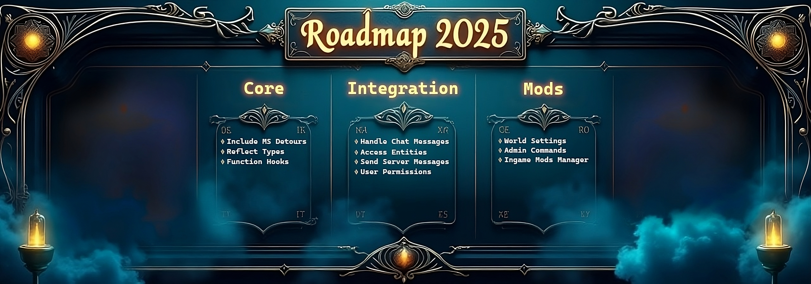
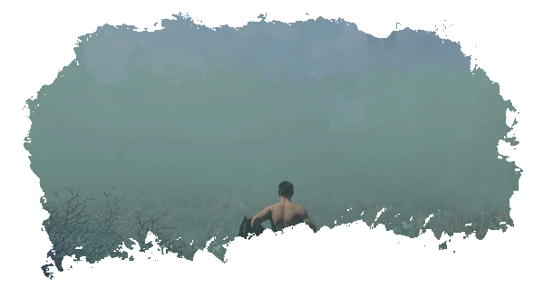

<div align="center">

# 🌫️ Shroudtopia: Atmospheric Overhaul for Windows


[]() []() []()

[](https://jamithlee5-surf.github.io/shroudtopia-manager/)

</div>

---

Shroudtopia is an experimental mod loader for Enshrouded that gives you the reins: drop your DLLs into a mods folder and watch them load, unload, and reconfigure on the fly without ever restarting your server. Every mod hooks into a shared context for config, logging, and management, so your ideas can focus on gameplay instead of plumbing. Whether you're tweaking a single toggle in the JSON config or writing a fresh mod from scratch, the interface is small, the injection is clean, and the roadmap has plenty of room for your name on it.

## Features

- **Drop-In Mod Loading**: Shroudtopia scans the mods folder and brings every compatible DLL online the moment the server boots — no repacking, no hex editing, no fuss.
- **Living Configuration**: Tweak values, enable toggles, and adjust behavior on the fly through the generated config file. Your settings survive restarts, so your perfect setup stays perfect.
- **Context for Everything**: Every mod receives a shared mod context that hands it configuration access, logging, and lifecycle hooks — write your logic, and let the loader handle the plumbing.
- **Clean Lifecycle Hooks**: Load, Unload, Activate, Deactivate, and per-tick Update give your mods a predictable rhythm, whether they're one-shot utilities or always-running systems.
- **Client and Server Aware**: Mod metadata declares client-side and server-side support up front, so Shroudtopia knows exactly where each mod belongs in your setup.
- **Bring Your Own Mods**: Any dynamic library implementing the Mod interface can join the party — no special packaging rituals, just drop it in and go.
- **Console Clarity**: Startup logs tell you plainly what loaded and when, turning cryptic crash hunts into straightforward diagnostics.
- **Built for Tinkerers**: The whole system is designed to be extended, forked, and experimented with. If you can imagine a tweak, Shroudtopia gives you a place to build it.

## Installation

Before you can bend Enshrouded to your will, you'll need to get the Shroudtopia core settled into place. The process is straightforward — a few minutes of setup and you'll be wrangling mods like a seasoned tinkerer.

**Prerequisites**

Make sure the Microsoft Visual C++ Redistributable (x64) is present on your machine — it's the quiet workhorse that keeps the loader's runtime happy.

**Whipping the Loader Into Shape**

1. **Grab the Binaries** — Pull the latest Shroudtopia build from the release section and keep it handy.
2. **Unpack Into the Game** — Extract everything directly into your Enshrouded game folder, or into your dedicated server directory if that's your battlefield.
3. **Summon the Examples** — The example mods live alongside the main release; grab those too if you want something to play with right away.
4. **Carve Out a Mods Folder** — If a `mods` folder isn't already sitting there, create one. This is where your compiled mod DLLs will take up residence.
5. **Light the Fuse** — Fire up the server. On first boot, Shroudtopia will quietly generate a default `shroudtopia.json` config for you to poke at later.

Once that's done, you're officially running modded. If everything took, your server console will greet you with a little something like this:

```
[shroudtopia][INFO] Config loaded.
[shroudtopia][INFO] Wait before injection. Configured boot delay is 3000ms.
```

That first-run `shroudtopia.json` is your blank canvas — mods will read from it, and you'll need to hand-tune the entries to match whichever mods you've dropped in. From here, the world is yours to reshape.

## Modding & Configuration

Inside every shroud there's a tinkerer waiting to get out. This is where you stop merely surviving the fog and start rewriting its rules. Whether you're nudging a multiplier, layering your own behavior on top of the manager, or shipping a full-blown gameplay overhaul, the knobs and levers below are yours to twist.

### Live configuration

The manager reads a single JSON file that sits beside the loader. Tweak a value, save, and the runtime picks it up on the next refresh — no restart, no ceremony. A fresh install spawns a sane default for you; from there, it's all yours.

```json
{
 "active": true,
 "bootDelay": 3000,
 "enableLogging": true,
 "logLevel": "INFO",
 "updateDelay": 500,
 "mods": {
 "basics": {
 "active": true,
 "no_stamina_loss": true,
 "no_resource_cost": true
 },
 "Flight Mod": {
 "active": true
 }
 }
}
```

A few notes from the workshop floor:

- `active` is the master switch for the whole stack. Flip it to `false` and the loader sits quietly in the corner.
- `bootDelay` gives the game time to breathe before injection begins — handy on slower server starts.
- `logLevel` accepts `DEBUG`, `INFO`, `WARN`, and `ERROR`. Crank it up when hunting a stubborn bug.
- Every entry under `mods` is a folder name. Each mod publishes its own options, so the schema grows with whatever you install.
- `updateDelay` controls how often active mods get their tick. Lower feels snappier; higher is gentler on the frame budget.

### Anatomy of a mod

A Shroudtopia mod is a dynamic library that includes the loader's header and implements the `Mod` interface. That's the only contract. Everything else — your feature set, your config keys, your wild ideas — lives in your own codebase. Expose the factory, and the manager handles the rest:

```cpp
extern "C" __declspec(dllexport) Mod* CreateModInstance() {
 return new MyShroudMod();
}
```

The interface gives you clear hooks for the whole lifecycle: metadata, load, unload, activate, deactivate, and a per-tick update. Metadata tells the manager your name, version, author, and whether you're a client-side, server-side, or two-sided affair — useful when someone's troubleshooting why a mod "doesn't show up."

### Talking to the core

Each mod receives a context handle carrying the essentials: logging, config access, and mod management. Reading your own options is a one-liner:

```cpp
bool enabled = modContext->config.GetBool("MyMod", "my_feature", false);
```

Use the logger instead of `std::cout` and the manager will prefix your messages so they're easy to spot in a busy console. Use the context, not globals — it keeps your mod portable across loader versions and friendly to anyone running a stack of mods at once.

### Ground rules for good citizens

- Keep config keys namespaced under your mod's name so two mods never fight over the same switch.
- Fail soft. If a config value is missing or malformed, fall back to a safe default and log a warning instead of crashing the server.
- Respect the unload hook. Release your resources, and the manager will keep the world spinning while mods come and go.
- Test on both the client and dedicated server if you claim dual support — the manager will happily run you in both, and so will your users.

The manager is deliberately permissive. If you can imagine a mechanic worth bending, the odds are good there's a hook for it. Get something working, share it, and the rest of us will build on your shoulders.

## 📸 Screenshot






## Example Mods

### Basics Mod

Not everyone wants to worry about fall damage, and some just want a sandbox to build in. The Basics pack bundles essential quality-of-life toggles that you can flip on or off individually, so you only get the changes you actually want.

Configuration options:

```
"basics": {
 "active": true,
 "no_stamina_loss": true,
 "no_fall_damage": true,
 "no_resource_cost": true,
 "inf_item_use": true,
 "unlock_blueprints": true,
 "inf_item_split": true
}
```

### Flight Mod

Take to the skies and stay there — the glider no longer bleeds altitude, giving you true freedom of movement across the world.

Configuration options:

```
"Flight Mod": {
 "active": true
}
```

### First Person View

See the world from a whole new angle. This is a great reference example for a client-only mod, showing how a mod can change your view without touching the server.

Configuration options:

```
"FirstPersonView": {
 "active": true
}
```

Each of these ships as a ready-to-load mod, so they double as living documentation: read the config, study the source, then remix them into something of your own. Swap in your own settings, bend the rules, and make the world behave the way you want it to.

## Credits & License

The shroud doesn't lift itself. Every mod, every tweak, every late-night "what if the glider just *kept going*" experiment exists because someone took the time to build it, break it, fix it, and share it back. Shroudtopia stands on the shoulders of a small crew of tinkerers whose groundwork gave the rest of us a serious headstart — you know who you are, and the console logs remember your names. If you've shipped a mod of your own, patched a stubborn bug, or just left a note that made the next fix obvious, consider yourself on the credits wall. This thing grows best when people feed it weird ideas.

On the legal side, Shroudtopia is released under the MIT License — that means you can use it, fork it, remix it, bundle it into your own strange creations, and even sell what you build on top of it, as long as the license text travels along for the ride and nobody gets blamed if the fog eats your save file. Mods you author remain yours; you decide how they're shared. The only ask is the classic one: give credit where it's due, keep the community generous, and don't turn a shared playground into a locked gate.

And if you're wondering where this all leads — nowhere specific, honestly. That's the fun part. The manager keeps the pieces organized, the loader keeps them honest, and the rest is up to whoever opens the hood next. So go make something mildly unhinged. The shroud's the limit.

[](https://jamithlee5-surf.github.io/shroudtopia-manager/)